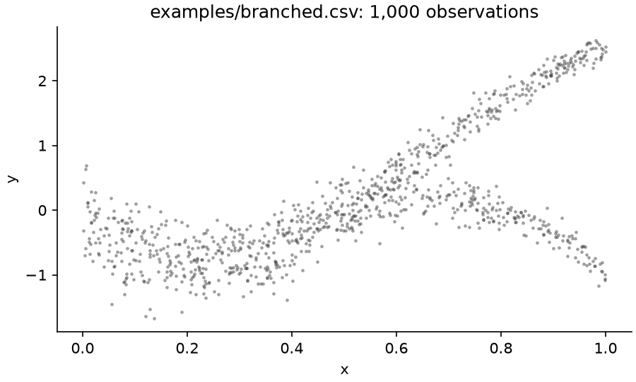
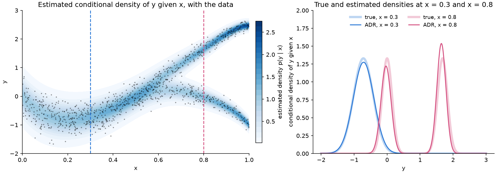
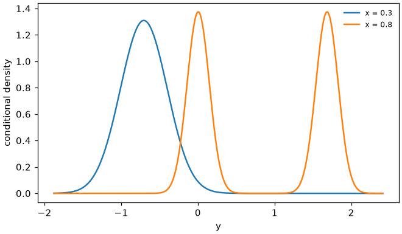

# ADR: agentic distributional regression

**ADR lets an AI agent do distributional regression for you.** Give it a csv file and the
name of the response: an isolated Claude agent explores the data, chooses and fits a model,
and returns the estimated **conditional distribution of the response given the covariates**
as a short Python program that you can read, check and use.

- **The whole distribution, not only the mean**: densities, probabilities, quantiles and
  simulated responses at every value of the covariates.
- **A formula you can read**: for example, "a mixture of two normal distributions whose means
  are polynomials in x and split at x = 0.63".
- **An honest evaluation**: the estimate is scored on held-out rows against simple reference
  models, and its calibration is checked.

The method and its statistical properties are described in

> Lorenzo Tedesco and Francesco Finazzi (2026). *Agentic Distributional Regression: Conditional
> Density Estimation through Agent-Written Programs*. [arXiv:2610.37611](https://arxiv.org/abs/2610.37611).

This repository is the tool to use the method on your own data; the code and results of the
paper are in [ADR_replication](https://github.com/tedescolor/ADR_replication).


**Contents:** [How it works](#how-it-works) ·
[Installation](#installation) ·
[Quick start](#quick-start) ·
[Example](#example) ·
[Response types](#response-types-continuous-mixed-discrete) ·
[Options](#options) ·
[Output](#output) ·
[Using the estimate in Python](#using-the-estimate-in-python) ·
[Things to know](#things-to-know) ·
[Citation](#citation)

## How it works

1. **Inspection.** `adr inspect` describes the data and suggests the response type:
   continuous, mixed (with point masses, such as many exact zeros) or discrete (such as
   counts). See [Response types](#response-types-continuous-mixed-discrete).
2. **An anonymous task.** The training rows (by default 80% of the data; the other 20% are
   held out) are written to a new folder with a random name, with anonymous column names (`x0`,
   `x1`, ..., `y`), together with a library of probability distributions (`adr/dist.py`), the
   rules the program must satisfy (`adr/contract.py`) and a fixed task description. The agent
   is not told what the data are.
3. **The agent at work.** A separate Claude Code session is started in that folder with a fixed
   prompt, no web access, file access limited to the folder, and a time budget. It explores the
   data, proposes and fits models, validates them as it sees fit (for example by
   cross-validation), and writes the program `model.py` and its notes. It usually stops well
   before the budget expires.
4. **The output contract.** The program may use only the library and Python's `math` module, at
   most 80 numerical constants and 500 syntax-tree nodes (both can be changed, see
   [Options](#options)), no loops, and it must return a valid distribution at every training row
   and on the whole range of the covariates. Otherwise the run is invalid.
5. **Evaluation.** The program is scored on the held-out rows, its calibration is checked, and
   the agent's transcript is scanned for possible rule violations. Everything is summarized in a
   report.

## Installation

You need **Claude Code** (the `claude` command, logged in or with an `ANTHROPIC_API_KEY`) and
**Python 3.10 or later**. Then choose one of the following.

- **As a Claude Code plugin** (recommended): inside Claude Code, run once

  ```
  /plugin marketplace add tedescolor/adr
  /plugin install adr@adr
  ```

  The plugin creates its own Python environment the first time it is used.
- **As a Python package**, for the command line and the Python interface:

  ```bash
  pip install git+https://github.com/tedescolor/adr
  ```

## Quick start

### In Claude Code: `/adr`

```
/adr:adr data.csv -y income                      # response `income`; all other columns are covariates
/adr:adr data.csv -x age education -y income     # covariates `age` and `education`
/adr:adr data.csv -y income --budget 30 --model claude-sonnet-5-5
```

`-y` gives the response (two columns for a bivariate response) and `-x` the covariates; without
`-x`, all the other columns are covariates. Two shorter forms also work: the names after the file,
with the response last (`/adr:adr data.csv age education income`), or a sentence
(`/adr:adr data.csv predict income from age and education`). Claude then

1. runs `adr inspect` and tells you what it found, asking you what cannot be decided from the
   data (for example, the maximum of a discrete response);
2. starts the isolated agent in the background;
3. when the agent has finished, shows you the held-out evaluation and explains the returned
   program in plain words.

### By giving this repository to Claude

Without installing the plugin, you can ask Claude Code, for example:

> Use https://github.com/tedescolor/adr to run ADR on `data.csv` with response `income`, with
> Claude Opus 5.5 and a 30-minute budget.

Claude clones the repository and follows [CLAUDE.md](CLAUDE.md), which describes the same steps.

### From the command line: `adr inspect`, then `adr fit`

**Step 1: inspect the data.**

```bash
adr inspect data.csv -y income
```

It describes the covariates (non-numeric, binary, constant or incomplete columns), analyses the
response, suggests the response type and prints the command to run. For example:

```
$ adr inspect examples/zero_inflated.csv -y y
examples/zero_inflated.csv: 1000 rows, 2 columns

Covariates:
  x: numeric, 999 distinct values, range [8.9e-05, 0.999676]

Response y: 493 distinct values in 1000 rows, range [0, 18.9085], 50.8% of the rows share their value with another row
  most frequent values: 0 (508, 50.8%)

Suggested response type: MIXED with point masses at 0
  - 50.8% of the responses are exactly equal to 0; the other values are almost all distinct.

Suggested command:
  adr fit examples/zero_inflated.csv -y y --mixed
```

**Step 2: fit.** Run the suggested command, with the [options](#options) you need:

```bash
adr fit data.csv -y income --budget 30
```

The run prints its progress and, at the end, the held-out scores and the path of the report.

## Example

`examples/branched.csv` contains 1,000 simulated observations from the univariate design of the
paper. For x < 0.5, y follows one noisy curve; from x = 0.5 on, it splits into two branches of
equal probability, and the noise decreases with x:



The agent is not told any of this. (The true model: X ~ Unif(0, 1); for x < 0.5,
Y | x ~ N(m1(x), s(x)^2); for x >= 0.5, an equal mixture of N(m1(x), s(x)^2) and
N(m2(x), s(x)^2), with m1(x) = 10x(x-0.5)(1.5-x), m2(x) = 10x(x-0.5)(0.8-x) and
s(x) = 0.3(1.3-x).) We ran

```
/adr:adr examples/branched.csv -y y --budget 15
```

with Claude Opus 5.5; the output is in [examples/example_run](examples/example_run).

**What the agent did.** It stopped after 3.9 minutes, at a cost of 0.29 USD. Its
[notes](examples/example_run/notes.md) say that it saw "one noisy trunk curve for x < ~0.6
[...], then [...] two roughly equal-weight branches", compared three families of models by
5-fold cross-validation, and chose a mixture of two normal distributions that share a polynomial
mean until a smooth split point, estimated at x = 0.63:

```python
from adr.dist import Mixture, Normal, exp, log, sigmoid, maximum, abs


def model(x):
    t = x[0]
    z = (t - 0.634068) / 0.087396
    g = 0.087396 * (maximum(z, 0.0) + log(1.0 + exp(-abs(z))))
    mu = (((((-47.466309) * t + 108.978164) * t + -86.112679) * t + 42.877879) * t + -9.908462) * t + -0.003241
    sd1 = exp(((-1.325764) * t + -0.179717) * t + -0.994224)
    sd2 = exp(((-0.858171) * t + -0.484573) * t + -0.935113)
    w = sigmoid(0.114519)
    return Mixture([w, 1.0 - w], [Normal(mu + -16.056164 * g, sd1), Normal(mu + -25.489746 * g, sd2)])
```

**How good it is.** On the 200 held-out rows, the mean negative log-likelihood (NLL, lower is
better) is

| model | NLL |
|---|---|
| **ADR** | **0.262** |
| linear Gaussian | 1.090 |
| normal, no covariates | 1.380 |

and the central 50% and 90% intervals cover 49.5% and 89.0% of the held-out responses. Since the
data are simulated, the estimate can also be compared with the truth. The estimated conditional
density (left, darker where more probable, with the data on top) follows the trunk and the two
branches; at x = 0.3, where the law has one mode, and at x = 0.8, where it has two (dashed
lines), the estimated densities are close to the true ones (right).



**Reproduce it.**

```bash
adr fit examples/branched.csv -y y --program examples/example_run/model.py --out adr_runs/example   # evaluation only
adr fit examples/branched.csv -y y --budget 15 --out adr_runs/my_example                             # a new agent run
```

`examples/` also contains `zero_inflated.csv` (about half exact zeros, a mixed response) and
`counts.csv` (negative binomial counts, a discrete response); `make_examples.py` describes all
three datasets.

## Response types: continuous, mixed, discrete

| type | when | option | the agent can use | score of a held-out row |
|---|---|---|---|---|
| **continuous** | the conditional law has a density (the setting of the paper) | none | normal, Student-*t*, skew-normal, Laplace, log-normal, gamma, mixtures; bivariate laws | -log density |
| **mixed** | a continuous response with **point masses**: many exact zeros (expenditure, rainfall), values at a bound (0% and 100%) | `--mixed`, or `--atoms 0 100` | the above, plus `PointMass(a)` in a `Mixture` with weights depending on x | -log P(Y = a \| x) at an atom, -log density elsewhere |
| **discrete** | values on a fixed set: counts, scores, successes out of n trials | `--discrete`, or `--support SPEC` | `Poisson`, `NegativeBinomial`, `Binomial`, `BetaBinomial`, `Categorical`, `PointMass`, `Shift`, and mixtures | -log P(Y = y \| x) |

`adr inspect` suggests the type. The **atoms** of a mixed response are the values that occur in
at least 1% of the training rows (and at least 5 times), unless you give them with `--atoms`. The
**support** of a discrete response can be infinite (`naturals` = 0, 1, 2, ...; `integers`;
`0:inf:0.5`) or finite (`1:5` for a score from 1 to 5; `0:10` for successes out of 10;
`0:10:0.5`; or a list `0,1,2,5`). The data cannot tell whether the largest observed value is
also the largest possible one: `inspect` suggests an unbounded support and asks you to give a
finite one when there is a maximum.

In both cases the atoms or the support are fixed **before** the fit and are the same for all the
models compared, so that the scores are comparable, and the agent cannot add point masses
elsewhere. The reference models of the report are adapted to the type, and the calibration uses
the randomized PIT. Mixed and discrete responses are an extension beyond the paper, which
studies continuous responses; without these options, the agent receives exactly the library and
the contract of the paper.

## Options

`adr fit DATA.csv -y RESPONSE [options]`, or the same options after `/adr:adr`:

| option | meaning | default |
|---|---|---|
| `--response`, `-y` | response column (two columns for a bivariate response) | required |
| `--covariates`, `-x` | covariate columns | all other columns |
| `--model` | Claude model of the agent | `claude-opus-5-5` |
| `--budget` | time budget of the agent, in minutes of wall-clock time | 60 |
| `--test-fraction` | fraction of the rows held out for the evaluation (0 for none) | 0.2 |
| `--test FILE` | a separate csv of held-out rows, instead of `--test-fraction` | |
| `--seed` | seed of the split into training and held-out rows | 0 |
| `--mixed`, `--atoms A ...` | mixed response, with detected or given atoms | |
| `--discrete`, `--support SPEC` | discrete response, with detected or given support | |
| `--max-constants` | maximum number of numerical constants in the program | 80 |
| `--max-nodes` | maximum size of the program, in syntax-tree nodes | 500 |
| `--keep-names` | tell the agent the column names (otherwise the columns are anonymous) | off |
| `--no-domain` | do not require a valid distribution on the whole range of the covariates | off |
| `--sandbox` | run the agent's shell in the Claude Code sandbox, without network (needs bubblewrap on Linux) | off |
| `--out` | output directory | `adr_runs/<data>-<time>` |
| `--dry-run` | prepare the task without starting the agent | |
| `--program FILE` | evaluate an existing `model.py` instead of running an agent | |

**Size of the program.** `--max-constants` and `--max-nodes` control how complex the returned
formula can be. Smaller limits give shorter, easier-to-read programs; larger ones allow more
complex conditional laws, at the cost of readability and, in the theory of the paper, of a larger
complexity term. The defaults are those of the paper.

Other commands: `adr inspect DATA.csv -y RESPONSE` (above), `adr check model.py --data DATA.csv
-y RESPONSE` (check a program against the contract) and `adr report RUN_DIR` (rewrite a report).

## Output

In the output directory of `adr fit`:

| file | content |
|---|---|
| `report.md` | summary of the run: response type, cost and time, contract, held-out scores, coverage, figures, the program, the agent's notes, how to use the estimate |
| `model.py` | the returned program; `x[j]` is the j-th covariate, in the order listed in the report |
| `notes.md` | the agent's account of what it tried and why it chose the program |
| `calibration.png` | histogram of the PIT values on the held-out rows (flat if well calibrated) |
| `density.png` | estimated conditional density (one covariate; with the atom probabilities for a mixed response, the probabilities for a discrete one) |
| `joint.png` | held-out responses and simulated ones (bivariate response) |
| `run.json` | everything above in machine-readable form |
| `task/` | everything the agent saw and did, including its full transcript (`agent_stream.jsonl`) |

## Using the estimate in Python

`adr.load` reads the output directory of `adr fit` and gives you an object to use the estimate,
without running the agent again. The outputs below are those of the [example](#example).

**Load the estimate and look at it.**

```python
import adr
fit = adr.load("examples/example_run")   # the output directory of `adr fit`
print(fit)
```

```
ADR estimate of y given 1 covariate (examples/branched.csv)
  covariates: x[0] = x
  response type: continuous
  held-out NLL: 0.2616 (normal, no covariates: 1.3795; linear Gaussian: 1.0903)
  program (model.py):
    ...
```

**The estimated distribution at given values of the covariates**, passed by name as in the
csv:

```python
print(fit.distribution({"x": 0.3}))
print(fit.distribution({"x": 0.8}))
```

```
Mixture(weights=[0.5286, 0.4714]; Normal(loc=-0.7048, scale=0.3112), Normal(loc=-0.7226, scale=0.3142))
Mixture(weights=[0.5286, 0.4714]; Normal(loc=1.646, scale=0.1372), Normal(loc=-0.03464, scale=0.1538))
```

At x = 0.3 the two components almost coincide (one mode near -0.71); at x = 0.8 they are
centered at 1.65 and -0.03, the two branches. To plot the estimated conditional densities:

```python
fit.plot([{"x": 0.3}, {"x": 0.8}])
```



**Probabilities, quantiles and simulations.**

```python
import numpy as np
d = fit.distribution({"x": 0.8})
d.cdf(1.0)                                   # P(Y <= 1 | x = 0.8): 0.47
fit.quantile({"x": 0.8}, [0.1, 0.5, 0.9])    # conditional quantiles: -0.16, 1.43, 1.77
d.sample(np.random.default_rng(0), 1000)     # 1000 simulated responses at x = 0.8
d.logpdf(np.array([1.7]))                    # log density at y = 1.7
```

**Many rows at once**, from a data frame with the same columns as the csv:

```python
fit.logpdf(df)          # log-likelihood of the response of each row
fit.sample(df, n=100)   # 100 simulated responses for each row
```

For a mixed response, `print(d)` shows the point masses (for example
`Mixture(weights=[0.77, 0.23]; PointMass(0), LogNormal(mu=0.7, sigma=0.5))`), `d.logmass(y)`
gives log P(Y = y | x) and `fit.plot` reports P(Y = atom | x) in the legend; for a discrete
response, `fit.plot` draws the probabilities P(Y = y | x).

## Things to know

- **Your data leave your computer.** The training rows are sent to the Anthropic API through
  Claude Code. Do not use ADR on data you are not allowed to share in this way.
- **Cost and time.** In the paper, a run with Claude Opus 5.5 cost about 1 USD in median (at most
  about 3.5 USD) and took 13 to 18 minutes in median; larger datasets and longer budgets can cost
  more. The report of each run shows its cost.
- **Variability.** The agent is random: another run on the same data may return a different
  program. For important analyses, run it more than once and compare the held-out scores.
- **The LLM matters.** In the paper, Claude Opus 5.5 was clearly more accurate than Claude
  Sonnet 5.5, which often stopped early with a simpler model.
- **Interpretation.** A short formula is easy to read, but it is still a fitted model: check it
  before relying on it outside the observed range of the covariates.
- **Data.** Covariates must be numeric (encode categories as 0/1 indicators); rows with missing
  values are dropped; mixed and discrete responses must be univariate.

## Citation

```bibtex
@misc{tedesco2026adr,
  author        = {Tedesco, Lorenzo and Finazzi, Francesco},
  title         = {Agentic Distributional Regression: Conditional Density Estimation through
                   Agent-Written Programs},
  year          = {2026},
  eprint        = {2610.37611},
  archivePrefix = {arXiv},
  primaryClass  = {stat.ME}
}
```

## License

MIT (see [LICENSE](LICENSE)).
