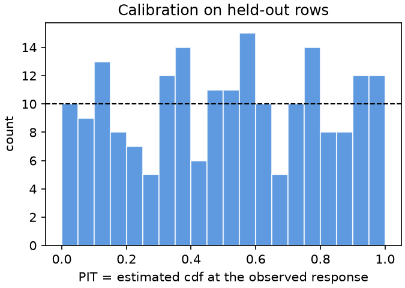
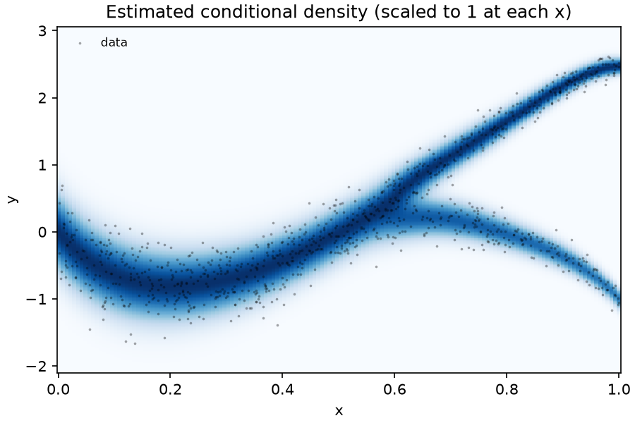

# ADR run: `examples/branched.csv`

Response: `y`. Covariates (1): `x`.
Training rows: 800; held-out rows: 200.
Response type: continuous (density with respect to Lebesgue measure).

## Agent run

- model: `claude-opus-5-5`; time budget: 15 minutes
- status: finished, after 3.9 minutes and 11 turns
- cost reported by Claude Code: 0.2902 USD
- output contract: satisfied
- audit flags: 0

## Held-out evaluation

Mean negative log-likelihood on the held-out rows (lower is better):

| model | NLL |
|---|---|
| **ADR** | **0.2616** |
| normal, no covariates | 1.3795 |
| linear Gaussian | 1.0903 |

Coverage of the central 50% and 90% intervals on held-out rows: 49.5% and 89.0% (nominal 50% and 90%).





## Returned program

In `model.py`, `x[j]` is the j-th covariate in this order: `x[0]` = `x`.

```python
from adr.dist import Mixture, Normal, exp, log, sigmoid, maximum, abs


def model(x):
    t = x[0]
    z = (t - 0.634068) / 0.087396
    g = 0.087396 * (maximum(z, 0.0) + log(1.0 + exp(-abs(z))))
    mu = (((((-47.466309) * t + 108.978164) * t + -86.112679) * t + 42.877879) * t + -9.908462) * t + -0.003241
    sd1 = exp(((-1.325764) * t + -0.179717) * t + -0.994224)
    sd2 = exp(((-0.858171) * t + -0.484573) * t + -0.935113)
    w = sigmoid(0.114519)
    return Mixture([w, 1.0 - w], [Normal(mu + -16.056164 * g, sd1), Normal(mu + -25.489746 * g, sd2)])
```

## Notes of the agent

# Notes

Data: y follows one noisy trunk curve for x < ~0.6 (noise sd larger at small x), then splits
into two roughly equal-weight branches: an upper one rising to ~2.5 and a lower one falling to ~-1 at x=1.

Validation: 5-fold CV (fixed random split), MLE refitted per fold with BFGS + random restarts.

Candidates (mean CV NLL):
- A: 2-Normal mixture, independent polynomial means, log-sd polynomials, logistic weight in x:
  (3,1) 0.2196, (4,1) 0.2141, (4,2) 0.2204, (5,2) 0.2204
- B: shared trunk polynomial mu(x) (deg dm) + branch offsets a_k * g(x), where
  g = softplus split ramp at a learned point t0 (~0.63) with learned width; log-sd quadratic per
  component, constant weight:
  (3,1) 0.215, (4,1) 0.2185, (5,1) 0.2132, (5,2) 0.2107

- C: B(5,2) with Student-t components: nu -> ~1800 (Gaussian), CV 0.2097, no real gain; kept Normal.

Chosen: B(5,2): it builds in the branching structure (one curve before the split, two after) and
had the best CV. ~22 fitted constants. Train NLL 0.186, CV 0.2107.

expected_nll: 0.215

## Using the estimate

```python
import adr
fit = adr.load("examples/example_run")   # this directory
print(fit)                     # summary and program
d = fit.distribution({"x": ...})   # covariates by name
print(d)                       # the estimated distribution at these covariates
d.cdf(y); d.ppf(0.9); d.sample(rng, 100)
fit.plot([{"x": ...}, ...])   # conditional densities at some covariate values
```

Another run on the same data may return a different program. Method: Tedesco and Finazzi, *Agentic Distributional Regression*, arXiv:2610.37611.
